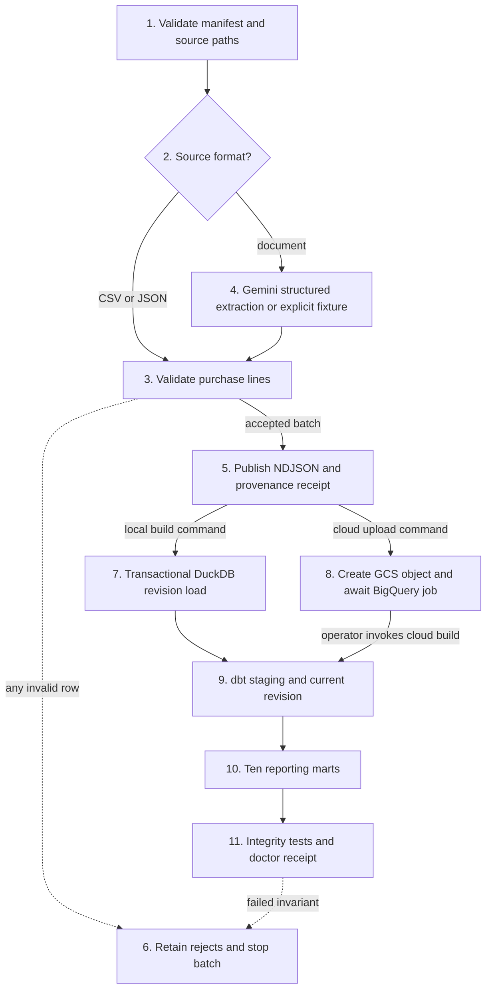
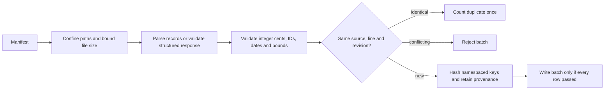
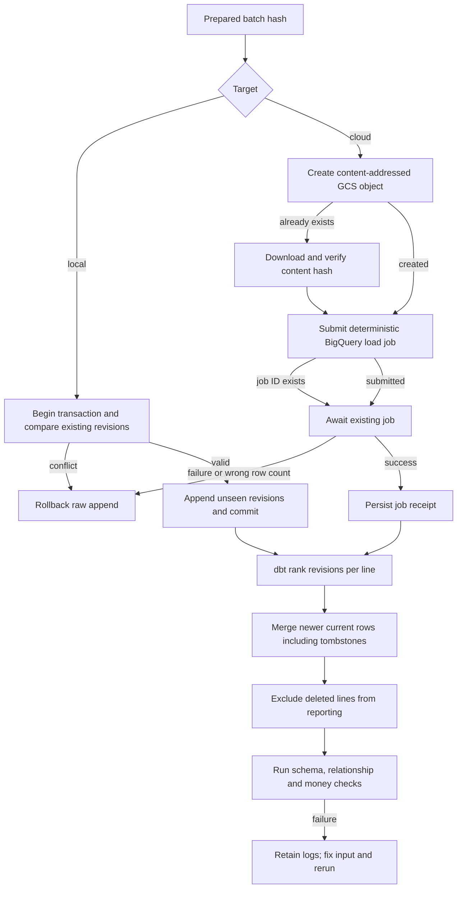

# Document data warehouse

Python document extraction, Cloud Storage ingestion and a BigQuery/dbt purchase warehouse. A local DuckDB target runs the same SQL model graph without creating cloud resources. Purchase lines retain their source, content hash and revision; revisions update a current-state table and tombstones remove lines from reporting without erasing raw history.

This is independently written code based on [UT Austin CS329E extraction](https://www.cs.utexas.edu/~scohen/cs329e_spr25/projects/project2.pdf), [dbt pipeline](https://www.cs.utexas.edu/~scohen/cs329e_spr25/projects/project6.pdf) and [incremental-update](https://www.cs.utexas.edu/~scohen/cs329e_spr25/projects/final-project.pdf) assignments. It is an adaptation for self-study, not enrollment or course-completion evidence. The repository contains four synthetic source-system fixtures, including an explicitly captured document response. These are not four independently published datasets and do not establish Gemini extraction accuracy.

## Contents

- [Walk through a purchase correction](#review-walkthrough)
- [Architecture and flow](#architecture-and-flow)
- [Implementation techniques](#implementation-techniques)
- [Terminology](#terminology)
- [Run and verify](#run-and-verify)
- [Measurements](#measurements)
- [Google integration and course scope](#google-integration-and-course-scope)
- [Resume bullets](#resume-bullets)

<a id="review-walkthrough"></a>

## Walk through a purchase correction

The fixture contains 80 lines from four synthetic source systems. `supplier-1` later corrects `line-0` to add two units and sends a deletion for `line-1`. Both use revision 2. The CLI validates the new batch, compares revision payloads with raw history, and appends exactly two raw revisions. dbt replaces the current version of those two keys, retains the deleted row as a tombstone, and rebuilds the reporting tables. The active line count becomes 79, raw history contains 82 revisions, and replaying the same correction changes neither total.

Follow [input validation](#flow-step-validate), [revision loading](#flow-step-load), [incremental selection](#flow-step-current), and [currency-aware reporting](#flow-step-marts). [scripts/verify.py](scripts/verify.py) drives these commands and checks actual database state. Its [receipt](evidence/verification.json) survives scratch cleanup.

<details>
<summary>Decisions to explain in an interview</summary>

Why keep deleted rows in the intermediate table? If an incremental model filtered them out first, the old active row could remain indefinitely. The tombstone must reach the merge before reporting filters it. Why compare a revision per key instead of one global timestamp? A late correction can have an older business date while still being the newest version of its line. Why group totals by currency? Adding euros and dollars without an exchange-rate policy produces a meaningless amount.

See [revision-aware refresh](#technique-revisions), [tombstones](#technique-tombstones) and [exact money](#technique-money).

</details>

## Architecture and flow

The operator invokes `prepare` and then either local `build`, or cloud `upload` followed by cloud `build`. A prepared batch is the persisted handoff between these separate commands. Gemini runs only for document sources when fixture extraction is not explicitly selected.



### Ingestion subsystem



### Storage, refresh and failure subsystem



Cloud upload and dbt builds are separate operations. A failed build can leave raw revisions and some rebuilt models present. This is not an atomic multi-table publication protocol. Consumers that need one consistent version should use separately versioned datasets and an explicit publication step.

### Steps, techniques and source

| Step | Operation and handoff | Techniques | Implementation |
| --- | --- | --- | --- |
| <a id="flow-step-manifest"></a>1 | Read bounded source list and confined local paths | [Boundary validation](#technique-boundaries) | [Manifest and confined](warehouse/domain.py), [prepare](warehouse/ingest.py) |
| <a id="flow-step-parse"></a>2 | Select CSV, JSON array or document path | [Typed records](#technique-boundaries) | [prepare](warehouse/ingest.py) |
| <a id="flow-step-validate"></a>3 | Validate records and reject conflicting revisions | [Money](#technique-money), [revision keys](#technique-revisions) | [Line](warehouse/domain.py), [prepare](warehouse/ingest.py) |
| <a id="flow-step-extract"></a>4 | Send document bytes and response schema to Gemini or validate an explicit captured fixture | [Structured output](#technique-structured-output) | [extract_gemini](warehouse/ingest.py) |
| <a id="flow-step-publish"></a>5 | Write raw.ndjson and prepare.json after validation | [Provenance](#technique-provenance) | [prepare](warehouse/ingest.py) |
| <a id="flow-step-reject"></a>6 | Retain rejects, logs and nonzero exit; do not load invalid batch | [Failing integrity checks](#technique-integrity) | [prepare](warehouse/ingest.py), [CLI](warehouse/__main__.py) |
| <a id="flow-step-load"></a>7 | Validate raw hash and append unseen versions transactionally | [Transactions](#technique-transactions), [revision keys](#technique-revisions) | [load_local](warehouse/build.py) |
| <a id="flow-step-cloud"></a>8 | Create GCS object and await BigQuery append job | [Content addressing](#technique-content-addressing), [job retries](#technique-cloud-retries) | [upload_batch](warehouse/cloud.py) |
| <a id="flow-step-current"></a>9 | Rank revisions and merge changed current rows | [Window functions](#technique-revisions), [tombstones](#technique-tombstones) | [stg_lines](models/staging/stg_lines.sql), [int_lines](models/intermediate/int_lines.sql) |
| <a id="flow-step-marts"></a>10 | Materialize dimensions, invoices and currency-aware reports | [Dimensional models](#technique-dimensional-models), [exact money](#technique-money) | [models/marts](models/marts) |
| <a id="flow-step-proof"></a>11 | Run dbt integrity tests and query actual durable state | [Data tests](#technique-integrity) | [schema tests](models/schema.yml), [cross-table tests](data_tests), [doctor](warehouse/build.py) |

## Implementation techniques

<a id="technique-boundaries"></a>
<details>
<summary>Typed records and boundary validation</summary>

[domain.py](warehouse/domain.py) defines a purchase line, bounded integer money and quantities, ISO dates, source formats and source list. CSV digit strings can become exact integers; booleans and floating point quantities cannot. Paths must resolve inside the manifest directory and files are bounded at 20 MiB. The alternative is permissive parsing with late SQL cleanup. Early rejection makes invalid data visible before writes but requires fixing a whole batch. File size limits are per source; this is an in-memory batch CLI, not an unlimited streaming importer.

</details>

<a id="technique-structured-output"></a>
<details>
<summary>Structured Gemini extraction</summary>

[extract_gemini](warehouse/ingest.py) sends document bytes through the official Google Gen AI SDK and requests the same Pydantic response schema used after receipt. Schema validity does not establish factual accuracy. Unknown fields and missing required values stop the operation. A deterministic parser is preferable for a fixed document format; Gemini supports less uniform inputs but needs a labeled document evaluation, privacy review and a cloud budget before use. The included captured response tests parsing, not the model.

</details>

<a id="technique-provenance"></a>
<details>
<summary>Source provenance and namespaced keys</summary>

[prepare](warehouse/ingest.py) retains source names, UTC load times, file hashes and normalized payload hashes. A source name and line ID form a namespaced record key, so two suppliers both using `line-0` do not overwrite each other. Supplier, invoice and product keys use the same principle. Global business identifiers are an alternative when a trusted cross-source registry exists. Namespacing avoids accidental merges but leaves cross-source entity resolution to a separate step.

</details>

<a id="technique-money"></a>
<details>
<summary>Integer cents and currency-aware aggregation</summary>

[Line](warehouse/domain.py) accepts nonnegative integer unit prices and bounded quantities; [fct_invoice_lines](models/marts/fct_invoice_lines.sql) multiplies them as integers. Spend reports group by currency. Floating point can introduce cent errors; arbitrary decimal precision is useful for currencies or instruments with other scales. This project deliberately models two-decimal amounts already converted to cents, supports no exchange-rate conversion, and is not a payment system.

</details>

<a id="technique-transactions"></a>
<details>
<summary>Transactional revision loading</summary>

[load_local](warehouse/build.py) checks file hashes, opens a DuckDB transaction, rejects a different payload at an existing key/revision and inserts unseen revisions. Replaying an identical batch does not duplicate history. Replacing the raw table is simpler but loses revision evidence; append-only without conflict checks can silently change historical meaning. This transaction protects raw loading only, not the subsequent multi-model dbt build.

</details>

<a id="technique-revisions"></a>
<details>
<summary>Window ranking and revision-aware incremental refresh</summary>

[int_lines.sql](models/intermediate/int_lines.sql) uses `row_number()` over each record key ordered by descending revision, then compares that revision with the existing current row. BigQuery uses `merge`; DuckDB uses dbt's `delete+insert`. A global load-time watermark can miss late records, so this implementation scans raw versions to find the latest per key. That scan makes correctness simple and bounds the expected speed benefit; partitioned ingestion and change manifests would be the next step at larger scales. A singular data test also rejects conflicting payload hashes at the same revision.

</details>

<a id="technique-tombstones"></a>
<details>
<summary>Tombstones for incremental deletes</summary>

The newest row can carry `deleted=true`. It remains in [int_lines](models/intermediate/int_lines.sql), replaces the previous current row, then [fct_invoice_lines](models/marts/fct_invoice_lines.sql) filters it out. Filtering a tombstone before the merge would leave the stale active row. Physical deletion saves space but removes replay history. Restoring a line requires a higher revision with `deleted=false`.

</details>

<a id="technique-content-addressing"></a>
<details>
<summary>Content-addressed objects and generation preconditions</summary>

[upload_batch](warehouse/cloud.py) names the object using SHA-256 of the prepared NDJSON and requests a create-only write with `if_generation_match=0`. If it already exists, the CLI downloads and checks its bytes before continuing. Random object names create duplicates on retries; overwrite-in-place can race. Download verification costs bandwidth. A newly prepared batch includes a new load timestamp, so it can have a different object hash; record/revision semantics handle that downstream.

</details>

<a id="technique-cloud-retries"></a>
<details>
<summary>Deterministic cloud job identity</summary>

[upload_batch](warehouse/cloud.py) derives the load job ID from destination and batch hash, waits for completion, checks errors and row counts, and retains the real job ID. A duplicate job submission retrieves that job. Blind resubmission with random IDs can append twice after an uncertain result. This code has SDK contract coverage, not a live BigQuery receipt; permissions, location compatibility, job retention and operational recovery remain target-environment checks.

</details>

<a id="technique-dimensional-models"></a>
<details>
<summary>Dimensions, facts and explicit lineage</summary>

Ten [marts](models/marts) include supplier/product dimensions, invoice lines, invoice totals, spend by supplier/date/category/country, source quality and invoice anomalies. dbt `source()` and `ref()` define the dependency graph. Reusable dimensions make reporting joins explicit, while direct queries over raw documents mix parsing with business logic. Descriptions use a deterministic latest-revision/date/key order; they are not a slowly changing dimension history. Source quality and anomalies are visible diagnostic tables.

</details>

<a id="technique-integrity"></a>
<details>
<summary>Schema, relationship and cross-table integrity tests</summary>

[schema.yml](models/schema.yml) checks required fields, key uniqueness and relationships. [Singular tests](data_tests) check conflicting revision payloads, consistent invoice attributes and equal per-currency line/invoice totals. Python tests cover invalid input, exact parsing, duplicates, rollback, tampering and Google SDK request contracts. A passing exit code alone cannot prove the right rows were written, so the CLI driver independently queries counts and money totals after updates and replay. dbt can leave partial materializations on failure; inspect logs before serving results.

</details>

## Terminology

| Term | Meaning here |
| --- | --- |
| Raw, staging, intermediate, mart | Preserved input revisions; dbt source projection; latest per-line state; reporting tables. |
| Revision | Monotonically increasing version number supplied by a source for one line. |
| Tombstone | A newer version marking a line deleted while retaining its history. |
| Materialization | How dbt stores a model, such as a table or incremental merge. |
| Window function | A calculation over rows sharing a key; here it ranks versions without discarding columns. |
| Idempotence | Replaying an identical accepted operation has the same durable result. |
| Foreign key | A fact's supplier/product/invoice key must refer to an existing dimension or invoice. |
| GCS generation | The version of a Cloud Storage object used in conditional writes. |
| Fixture response | Explicit captured synthetic extraction output used in offline checks. |

## Run and verify

Python 3.11 and the pinned dependencies are sufficient for local operation.

```powershell
python -m venv .venv
.venv/Scripts/python -m pip install -r requirements.lock.txt
.venv/Scripts/python -m pytest -q
.venv/Scripts/python -m ruff check .
.venv/Scripts/python scripts/verify.py
.venv/Scripts/python -m warehouse prepare --manifest fixtures/manifest.json --output .runs/demo --fixture-extraction
.venv/Scripts/python -m warehouse build --run-dir .runs/demo
.venv/Scripts/python -m warehouse doctor --run-dir .runs/demo
```

Use a fresh output directory for each prepared batch. To apply corrections to an existing database, prepare a new batch and use `build --run-dir NEW_RUN --database PATH_TO_EXISTING_DB`. [The maintained verification skill](.agents/skills/verify-document-data-warehouse/SKILL.md) covers lifecycle and feature checks. Dependencies are isolated in `.venv`; generated state stays in `.runs`. The dbt run manifest and model/test results are retained with the local proof.

## Measurements

[benchmark.json](evidence/benchmark.json) retains 20 timed CLI builds, five repeats per mode at each scale. Each pair starts from a separate copy of the same baseline database and consumes the same revision batch. Ten percent of lines receive quantity updates and one percent receive tombstones. Timing includes CLI startup, raw load, every dbt model and all 39 integrity tests. Preparation, baseline builds and oracle queries are outside the timer. Every run checks the final active count, raw revision count and exact totals separately for each currency. All 20 passed their output oracles and exited successfully.

| Baseline lines | Mode | Median seconds | Observed range, seconds |
| --- | --- | --- | --- |
| 4,000 | Full refresh | 4.165 | 4.159-4.316 |
| 4,000 | Incremental current-state refresh | 4.212 | 4.170-4.384 |
| 40,000 | Full refresh | 4.921 | 4.795-4.984 |
| 40,000 | Incremental current-state refresh | 4.792 | 4.758-5.007 |

These overlapping local ranges do not establish a speed advantage. Both paths scan raw history and rebuild the reporting marts, and this shared workstation ran other project checks during the campaign. No isolated bottleneck profile was collected, so a causal speedup claim would be inconclusive. This is a local batch correctness/performance study, not cloud throughput, concurrent service load, a memory ceiling or extraction accuracy. Hardware, versions, source hashes, raw outcomes and dbt timing receipts accompany the campaign. The [earlier campaign](evidence/benchmark-before-review.json) remains available; a later review added strict date parsing, regional job replay and distinct revision/delivery accounting, followed by the full fresh campaign above.

The exact [recorded benchmark driver](evidence/benchmark-harness-recorded.txt) matches its receipt hash. The maintained driver later gained unique artifact directories to prevent subsequent runs overwriting per-node reports. All 20 refreshed per-node receipts match their recorded hashes; the [retention audit](evidence/retention.json) records that four older per-node receipts were overwritten before archival, while the complete earlier timing/count/oracle summary remains.

## Google integration and course scope

| Requirement | Code and evidence |
| --- | --- |
| Extract document data with Gemini | Official SDK integration and structured-response contract test implemented; live extraction and factual accuracy unmeasured. |
| Load structured files through GCS into BigQuery | Conditional object upload and awaited BigQuery load job implemented with contract tests; no live cloud job yet. |
| Multiple source systems and provenance | Four synthetic fixtures, including CSV, JSON and text-document capture. Independently published datasets and the full course anomaly collection remain future data work. |
| dbt staging/intermediate/marts | Twelve models including ten marts and 39 executed data tests on DuckDB. BigQuery target configured but unexecuted. |
| Python transformations on Dataproc | Adapted: Python extraction precedes ingestion; SQL expresses the warehouse transformations. No dbt Python/Dataproc execution is claimed. |
| Incremental inserts, updates and deletes | Latest-version selection, inserts, replay, updates and tombstones implemented; CLI proof verifies update/delete/replay. |
| Course notebook/submission | CLI adaptation with retained machine-readable evidence. No enrollment, Colab submission or instructor grading claimed. |

Cloud use needs a separately authorized project, existing same-location bucket/dataset, Application Default Credentials and appropriate Gemini, Storage and BigQuery permissions. Select the model explicitly. Model calls, storage and queries can cost money. The dbt BigQuery profile limits bytes billed per query, runs one thread and does not retry jobs automatically; this is not a project-wide spending cap.

```text
python -m warehouse prepare --manifest YOUR_MANIFEST --output NEW_RUN --project YOUR_PROJECT --model YOUR_MODEL
python -m warehouse upload --run-dir NEW_RUN --cloud --project YOUR_PROJECT --bucket YOUR_BUCKET --dataset YOUR_RAW_DATASET --location YOUR_DATA_LOCATION
python -m warehouse build --run-dir NEW_RUN --cloud --project YOUR_PROJECT --dataset YOUR_RAW_DATASET --location YOUR_DATA_LOCATION
```

Do not upload private documents without permission. There is no credential file in this repository. Object hashes can correlate repeated content; they are integrity identifiers, not anonymization. A local `doctor` command inspects DuckDB, not a remote target.

Primary integration references are the [Google Gen AI SDK](https://googleapis.github.io/python-genai/), [GCS JSON loading into BigQuery](https://docs.cloud.google.com/bigquery/docs/loading-data-cloud-storage-json), [dbt BigQuery adapter](https://docs.getdbt.com/docs/local/connect-data-platform/bigquery-setup) and [dbt DuckDB adapter](https://github.com/duckdb/dbt-duckdb). These maintained SDKs provide transport, credentials and execution; this repository implements purchase schemas, provenance, conflict policy, revision processing, SQL models and verification. Dependency licenses remain with their packages; the code in this repository uses the MIT license.

## Resume bullets

- Built a Python/SQL document warehouse with Gemini, Cloud Storage and BigQuery integration code, plus 12 dbt models and 39 locally executed integrity checks.
- Verified revision updates, deletes and replay over 40,000 synthetic purchase lines in repeated local builds with exact per-currency output oracles; five incremental runs completed in 4.76-5.01 seconds.

Use the local qualifier. Live GCP performance, extraction accuracy and production deployment have not been established.
